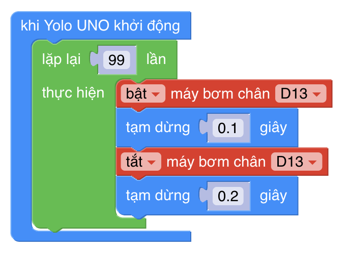

# Blink

This is a simple example. The Scratch code looks like this:



And in Python it would be:

``` py
from pins import *
from yolo_uno import *

pump_D13 = Pins(D13_PIN)

async def setup():

  print('App started')
  for count in range(10):
    pump_D13.write_digital(1)
    await asleep_ms(500)
    pump_D13.write_digital(0)
    await asleep_ms(200)

async def main():
  await setup()
  while True:
    await asleep_ms(100)

run_loop(main())
```

